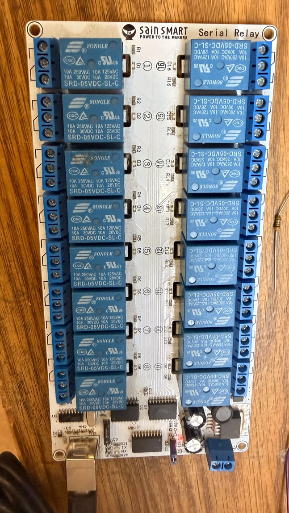
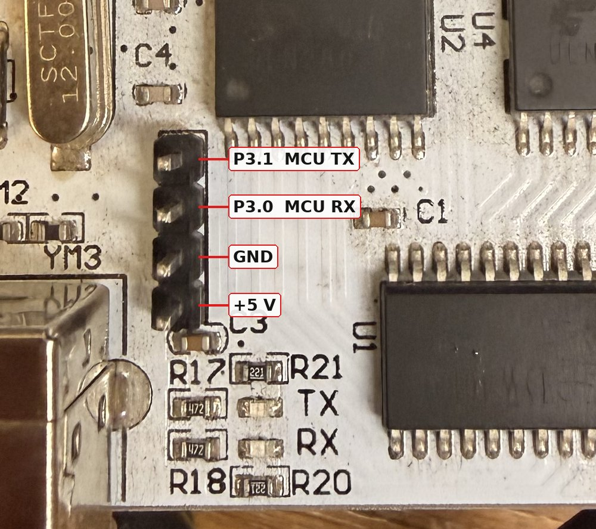

# sainsmart-relay16

Replacement firmware and host tools for the **SainSmart 101-70-208**
16-channel 9-36 V USB relay board, whose stock serial firmware is slow
(9600 baud Modbus ASCII, one relay per 17-byte command) and never reports
real status.

The relay16 firmware gives:

- plain ASCII commands at 115200 baud: `s 5`, `c 5`, `h F0F0`, `r`
- one command sets all 16 relays at once; every reply is the actual state
- a host-silence failsafe, a board ID in EEPROM so 8 boards keep the same
  index after every reboot
- the same hex mask as `usb-relay` (SainSmartUsbRelay): `0001` = relay 1
- full build only: board-timed pulses (`p 3 250`) and a per-relay max-on
  interlock

<p align="center"></p>

Protocol: [docs/PROTOCOL.md](docs/PROTOCOL.md).
Speed tests: [docs/PERFORMANCE.md](docs/PERFORMANCE.md).
Board IDs and board order: [docs/BOARD-IDS.md](docs/BOARD-IDS.md).
Hardware, flashing and pin map: [docs/HARDWARE.md](docs/HARDWARE.md)
([photos](docs/HARDWARE.md#photos)).

## Why

We run the fire effects on the Reared In Steel crew's pieces at Burning Man:
propane poofers, bigger propane effects and igniters on stacks of 16-channel
relay boards, sequenced live from MIDI (an 88-key keyboard, a MIDI controller
and a web interface). [Fire Kethedral](https://mycal.net/terms/fire-kathedral/)
runs seven boards; Medusa and Flower Tower run three or four each.

We built that rig on SainSmart's USB-HID 16-channel boards, driven by
[SainSmartUsbRelay](https://github.com/lowerpower/SainSmartUsbRelay)
(`usb-relay`). They were fast, they now have hundreds of thousands of clicks
on them, and you can't get them any more. The current
board, the 101-70-208, has a CH340 serial port instead, and the plug-in
controller boards for the relay modules are serial now too. The stock serial
firmware is far slower than the old HID boards: 9600 baud Modbus ASCII, one
17-byte command per relay at about 40 ms each, so a chord across 16 relays
lands over half a second late. It also never reports what the relays are
actually doing; every command just comes back as an echo.

So this is the replacement. Under the CH340 sits an STC 8051 that can be
reflashed through a 4-pin header. This firmware turns these serial boards into fast, reactive boards that scream
out our MIDI sequences at sub-10 ms resolution, on par with the old HID boards
we loved: one command sets all 16 relays in about 3-4 ms, and the reply is
the real relay state.

Fire needs two more things:

- **The same relay on the same board, every time.** With boards stacked, our
  software has to hit the same relay on the same board on every run. Firing
  the 10-gallon propane bomb when we wanted a small poofer or an igniter is
  not an option. The CH340 has no serial number, so each board stores its own
  ID in EEPROM, and the host finds boards by that ID, whatever the USB port
  or boot order. A missing or duplicate ID is an error; boards never
  renumber to fill a gap.
- **Nothing left on too long.** Relays always start off. A host-silence
  failsafe drops every relay if the controller stops talking. The full build
  adds board-timed pulses and a per-relay max-on limit, so a valve closes on
  time even if the host crashes mid-burst.

The hex masks match `usb-relay` (`h F0F0` does what `set F0F0` did), so the
old show logic carries over.

## Two builds

| | lite | full |
|---|---|---|
| Fits | stock STC15W401AS (1 KB) | STC15W404AS/408AS (chip swap) |
| Source | 8051 assembly, ~790 bytes | C, ~2.2 KB |
| Commands | `r s c h t i w v` | adds `p d m` |
| Tested | the assembled binary, in ucsim (17 tests) | the C core, in a Linux simulator (19 tests) |
| On real hardware | **verified** (see below) | **not yet tested** |

Both share the EEPROM layout, so IDs survive moving a board from lite to full.

**Lite is verified on a real board** (2026-10-25): all commands, relay walk
1-16 in order, failsafe timing, EEPROM save surviving a power cycle.
Setting all 16 relays with a confirmed reply takes 3-4 ms; 1000 random
patterns ran at 277 updates/s with every reply correct and nothing over
7 ms (stock firmware: ~40 ms per relay, no status). Details in
[docs/PERFORMANCE.md](docs/PERFORMANCE.md).
**The full build has not been tested on real hardware.** It has only run in
the Linux simulator; the STC15-specific parts (`firmware/stc15.c`: pins, UART
interrupt, timers, IAP EEPROM) have never executed on a chip, and it needs a
chip swap to a 404AS/408AS before it can. Treat it as untested until it has
been flashed and checked the way the lite build was.

## Layout

| Path | What |
|---|---|
| `firmware/lite/` | lite firmware (asm); `hw.asm` = board, `sim.asm` = ucsim build |
| `firmware/core.c` | full firmware protocol core, hardware independent |
| `firmware/stc15.c` | full firmware STC15 main: pins, UART, timer, EEPROM |
| `sim/sim.c` | runs `core.c` on Linux, on stdin or a pty |
| `host/relay16.py` | Python library and CLI (Windows, macOS, Linux) |
| `linux/` | udev rule: `/dev/relay16-<id>` |
| `test/` | protocol tests: full core on `sim`, lite binary on ucsim |
| `vendor/` | SainSmart's package (not committed) |

## Build and test

Needs `sdcc` 4.x, `sdcc-ucsim` (tests), `stcgal`, `python3-serial`.

```sh
make            # lite + full firmware, simulator
make test       # both test suites (~90 s; ucsim is slow)
```

Try the protocol without hardware:

```sh
sim/sim -v      # type: s 1 / h f0f0 / p 3 500 / r / v
```

## Flash a board

USB-TTL adapter on the 4-pin ISP header, with a 1 kohm pull-up from 5 V to
P3.1. The pin order is not what the schematic suggests:



Adapter RX to P3.1, adapter TX to P3.0, GND to GND, adapter 5 V left open
(the board runs from its own USB). The setup that flashed the first board,
and cable color notes, are in [docs/HARDWARE.md](docs/HARDWARE.md#photos).

```sh
make -C firmware info         # read-only handshake, then replug the board's USB
make -C firmware flash-lite   # stock chip; EEPROM (ID, settings) kept
make -C firmware flash        # 404AS/408AS; EEPROM kept
```

`PORT` defaults to the first serial adapter that isn't the board's CH340
(`/dev/serial/by-id/...`); pass `PORT=...` to choose another.

## Set up boards

Each board needs its own ID before it goes in a rig. How to set it, how to
choose IDs, and how `usb-relay` turns IDs into board order:
[docs/BOARD-IDS.md](docs/BOARD-IDS.md).

```sh
host/relay16.py -p /dev/ttyUSB0 i 3      # plug in alone, give it an ID
host/relay16.py -p /dev/ttyUSB0 w        # save
host/relay16.py scan                     # list all boards by ID
host/relay16.py -b 3 walk                # click relays 1-16 on board 3
host/relay16.py -b 3 bench               # round-trip latency
make -C linux install                    # /dev/relay16-3 on Linux
```

## Related projects

The rest of the fire-control chain these boards plug into, all at
[github.com/lowerpower](https://github.com/lowerpower):

```
MIDI keyboard -> midi-2-relay --+
                                +-- UDP "set <hex>" --> usb-relay --> relay boards
web UI (fire-controller-web) ---+
```

- [SainSmartUsbRelay](https://github.com/lowerpower/SainSmartUsbRelay):
  `usb-relay`, the C controller the rigs run today. Finds every SainSmart
  USB-HID board, gangs them into one long bitmask, and takes `set <hex>`
  commands interactively or over UDP. It drives the HID boards through
  hidraw and relay16 boards over serial, placing each relay16 board by its
  stored ID ([docs/BOARD-IDS.md](docs/BOARD-IDS.md)).
- [midi-2-relay](https://github.com/lowerpower/midi-2-relay): reads MIDI
  from a serial port, maps notes to relay outputs with a map file, and
  sends `set <hex>` over UDP to the relay controller.
- [fire-controller-web](https://github.com/lowerpower/fire-controller-web):
  the web UI for the fire controller (Flower Tower, Medusa), with riff files
  for sequences and per-piece personalities.
- [udpsend](https://github.com/lowerpower/udpsend): a command-line UDP
  packet sender, handy for poking the controller's UDP port by hand.
- [relay](https://github.com/lowerpower/relay): an earlier (2015) Node.js
  take on multi-board HID control with file playback, kept for history.

## Author

Mike Johnson (Mycal), https://anchorid.net/resolve/4ff7ed97-b78f-4ae6-9011-5af714ee241c

## License

MIT, see [LICENSE](LICENSE). Copyright (c) 2025-2026 Mike Johnson (Mycal).
SainSmart's vendor files (schematic, tools) are not included and are not
covered by this license.
